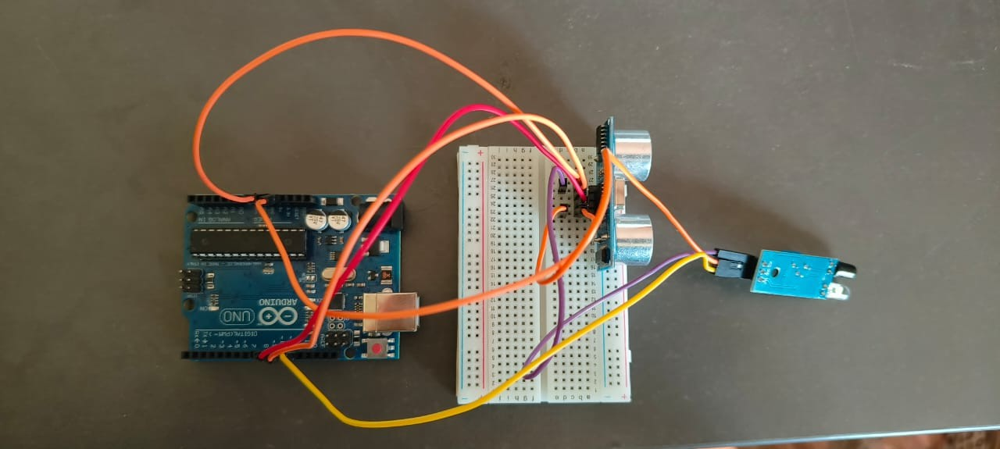
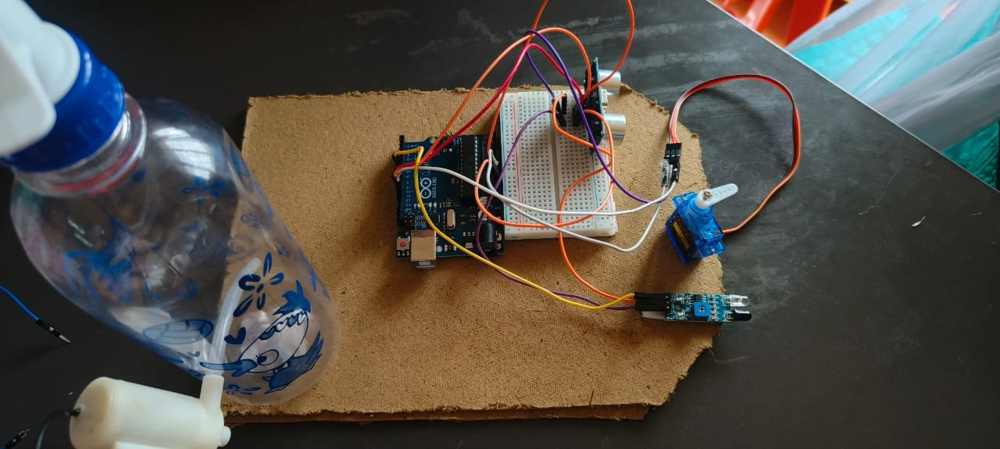
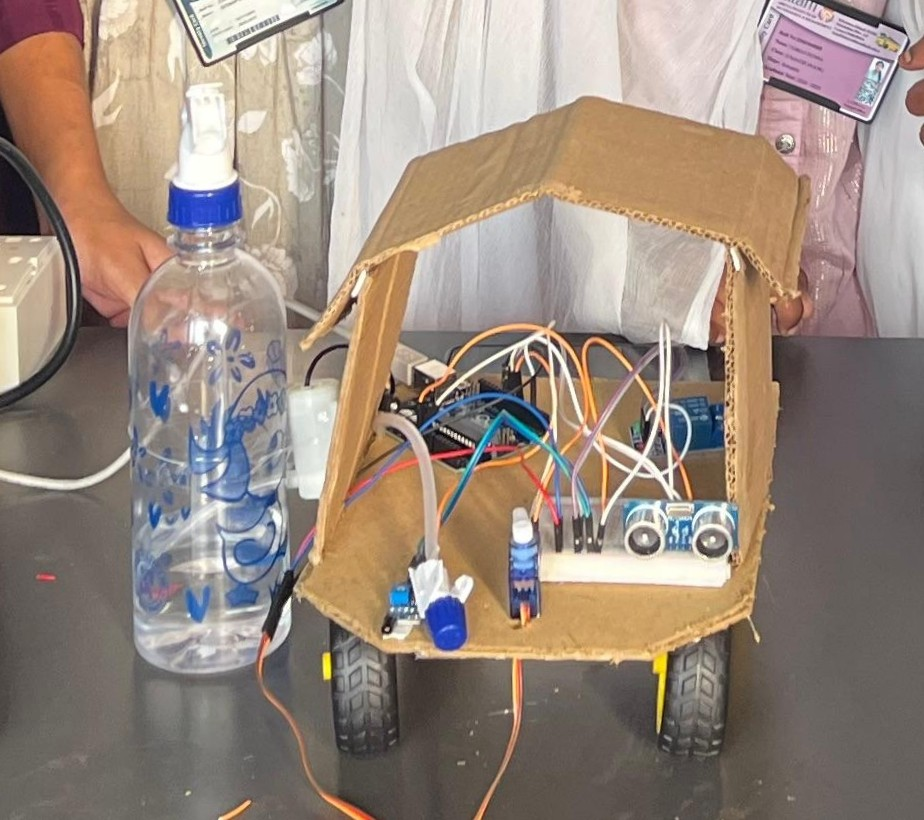

# Obstacle Avoiding and Fire Fighting Robot

## Project Overview

An Arduino Uno based robot that combines obstacle avoidance and basic firefighting capabilities using an ultrasonic sensor, flame sensor, servo motor, and water pump.

This was a team-based project developed as part of the **Arduino Explorer Mastery Workshop** conducted by the Department of CSE-AI&ML, AITAM Tekkali.

## Problem Statement

Autonomous robots may need to navigate safely while responding to hazards such as fire.

This project explores combining obstacle detection and basic firefighting into a single Arduino-based robot.

## Features

* Real-time obstacle detection using an ultrasonic sensor
* Flame/fire detection using a digital flame sensor
* Servo-driven sweep from 0° to 180°
* Automatic water spraying using a water pump
* Approximately 5-second spray when fire is detected
* Serial Monitor output for debugging and sensor readings

## Technologies Used

* Arduino Uno
* Arduino IDE
* C/C++
* Servo Library (`Servo.h`)

## Hardware Requirements

* Arduino Uno
* HC-SR04 ultrasonic sensor
* Digital flame sensor
* Servo motor
* Water pump
* Water bottle/reservoir
* Breadboard
* Jumper wires
* Cardboard chassis
* Wheels

## How It Works

1. The ultrasonic sensor continuously measures the distance to nearby objects.
2. The flame sensor checks for the presence of fire.
3. When a flame is detected, the servo sweeps from 0° to 180°.
4. The flame sensor is checked during the sweep to identify the flame direction.
5. The water pump is activated for approximately 5 seconds.
6. After spraying, the pump stops and the servo returns to its initial position.
7. If no flame is detected, the robot continues monitoring.

## Results

### Obstacle Avoidance

The obstacle avoidance feature worked partially. The robot was able to detect and avoid some objects, but the behavior was not consistent.

### Firefighting

The firefighting feature did not work reliably during testing. Fire detection and response required further calibration and improvement.

## Limitations

* Inconsistent obstacle detection and avoidance
* Unreliable flame detection
* Unreliable firefighting response
* Prototype-level cardboard chassis
* Limited sensor calibration and testing

## Future Improvements

* Improve ultrasonic sensor mounting and filtering
* Use sensor averaging for more stable distance readings
* Recalibrate or upgrade the flame sensor
* Improve servo sweep speed and accuracy
* Replace the cardboard chassis with a stronger design
* Add sensor-data logging
* Add a mobile or serial monitoring dashboard

## Project Images

### Breadboard Prototype

### Mid Assembly

### Final Robot

## Project Context

**Workshop:** Arduino Explorer Mastery Workshop
**Department:** CSE-AI&ML
**Institution:** AITAM, Tekkali

## My Role

**Monitoring & Documentation**

I contributed to project monitoring, documentation, testing observations, and recording the project results and limitations.

## Team Project

This project was developed collaboratively as a team project.
